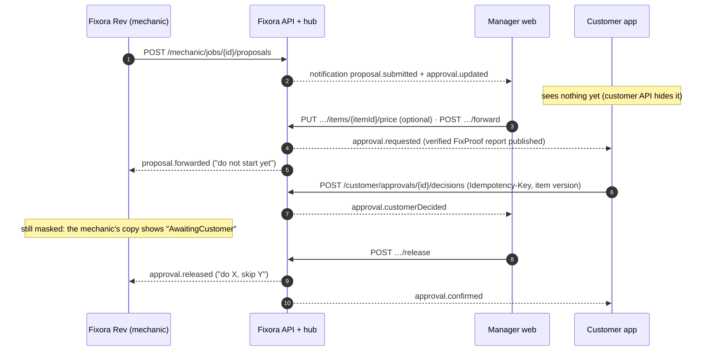
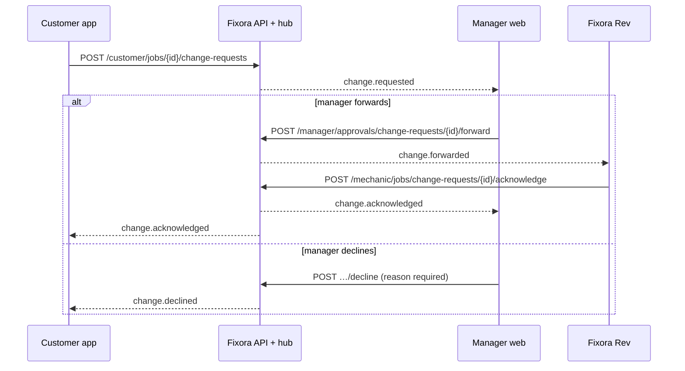

# Real-time approval routing

Every hand-off between the customer and the mechanic goes through the service manager.
Nothing reaches the other side until the manager acts, and every hop is pushed live over
SignalR (`/hubs/fixora`) and saved in the notification inbox at the same time.

## Route 1 — mechanic → manager → customer → manager → mechanic (repair proposal)

State machine (`RepairProposal`): `PendingManagerReview → AwaitingCustomer → CustomerResponded → ReleasedToMechanic`,
or `PendingManagerReview → ReturnedToMechanic`. A price raised more than 10 % (or a quantity change) after approval
puts the item back to `AwaitingCustomer` with a new version (BR-FP-08); a stale decision gets HTTP 409.

## Route 2 — customer → manager → mechanic (change request)

## Hub contract

| Group | Who joins | Used for |
|---|---|---|
| `user:{id}` | every connection | personal notifications, the customer's / mechanic's own proposal copy |
| `role:{role}` | every connection | role-wide broadcasts |
| `role:staff` | managers, owners, platform admin | every hand-off that needs the manager |
| `job:{id}` | after `JoinJob(jobId)` (access checked) | per-job live view |

Server → client events: `notification`, `approval.updated`, `changeRequest.updated`, `job.updated`,
`queue.updated`, `booking.updated`, `sos.updated`, `inventory.updated`.
**A realtime event never proves completion**: clients re-read the authoritative state from the API.

Order of delivery for a notification: persist (inbox) → SignalR → push (FCM sender is a logging stub in Phase 1).
A failed push never fails the business action.

## Verified

`tests/e2e/realtime_e2e.py` drives three live hub connections (manager, mechanic, customer) and asserts who receives
each event and who must not: 27 checks across proposals, change requests, SOS, booking capacity and FixProof draft privacy.

## Manager mode and Auto mode

| | Manager mode | Auto mode |
|---|---|---|
| Mechanic proposal | waits in Approvals for a manager | sent to the customer at once (proposals above the hold limit, or with an unpriced item, still wait) |
| Customer decision | waits for the manager to release | released to the mechanic at once |
| Customer change request | waits for forward / decline | forwarded to the assigned mechanic |
| Booking request | waits for confirm / decline | confirmed into a free bay with a free mechanic (else held) |
| SOS | waits for acknowledge / dispatch | acknowledged and dispatched to the least busy on-duty mechanic (else held) |

* Customers still approve or reject every repair item themselves. Auto mode never decides for a customer.
* Effective mode = Auto when a manager chose Auto in the header switch, **or** Manager mode is chosen, "Switch to Auto when no manager is online" is on and no manager/owner has had the dashboard open (live SignalR connection) for `AwayMinutes` (default 5).
* When a manager opens the dashboard again, Manager mode returns and staff get a "Welcome back" notification with what Auto mode handled and what it held.
* `AutoPilotWorker` runs every 5 s; changing the switch applies at once. Every action is logged (`control.AutoActions`), shown on the dashboard, and written to the approval audit trail with actor role `Auto`.
* Tables live in their own schema `control`, so an existing FixoraDb gets them on the next start.
* API: `GET/PUT /api/v1/manager/control`, `POST /api/v1/manager/control/seen`; realtime event `control.updated` to `role:staff`.
* Test: `tests/e2e/automode_e2e.py` (20 checks, incl. the 1-minute away take-over).
